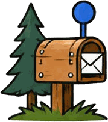
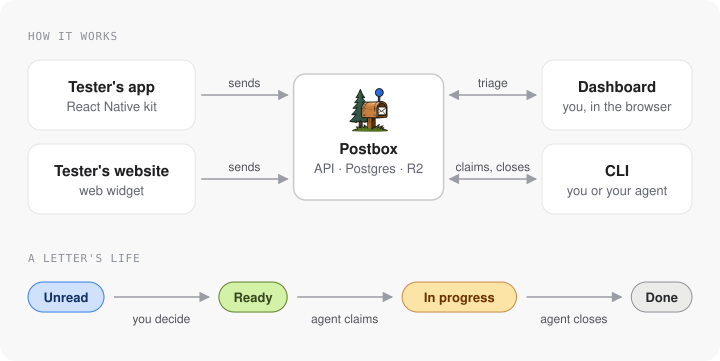
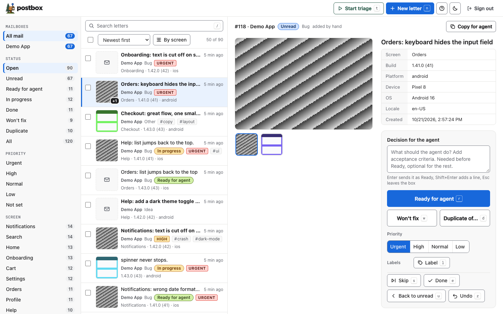

# Postbox

*Every voice finds its way to you.*

<!-- diagram source: docs/diagrams/architecture.json -->


Postbox is the place where letters arrive: a small, self-hosted inbox for the bug reports and ideas that testers send from your apps and websites.
Testers need no account; you read everything in one dashboard or hand an item to a coding agent with one CLI command.
It runs on Cloudflare Pages Functions, Neon Postgres (or any Postgres) and Cloudflare R2, and fits in the free tiers for a small team.



## Quick start

You need Node 22.18 or newer, pnpm, a Cloudflare account and a Postgres database (a free Neon project works).

```sh
git clone https://github.com/DalatHappyFarm/postbox.git
cd postbox
pnpm install

# 1. Pages project and R2 bucket (pick your own names; put the bucket name in wrangler.toml)
npx wrangler pages project create <your-project> --production-branch main
npx wrangler r2 bucket create <your-bucket>

# 2. Secrets (generate the admin token with: openssl rand -hex 32)
npx wrangler pages secret put DATABASE_URL --project-name <your-project>
npx wrangler pages secret put ADMIN_TOKEN --project-name <your-project>

# 3. Database schema (DATABASE_URL in the environment, never committed)
DATABASE_URL='postgres://...' pnpm db:migrate

# 4. Deploy (put your project name in `name` of wrangler.toml first)
scripts/deploy.sh main
```

Open the printed `*.pages.dev` address and sign in with the admin token.

To deploy on every push to `main`, the Deploy workflow (`.github/workflows/deploy.yml`) migrates and deploys staging, checks it, then does the same for production.
It runs once the repository has the variable `CLOUDFLARE_ACCOUNT_ID` and the secrets `CLOUDFLARE_API_TOKEN` (a token with Account > Cloudflare Pages > Edit), `DATABASE_URL_STAGING` and `DATABASE_URL_PRODUCTION`.
Create a mailbox (a project) with the CLI below, and give its public key to your app.

## Configuration

| Name | Where | Meaning |
|---|---|---|
| `DATABASE_URL` | Pages secret | Postgres connection string |
| `ADMIN_TOKEN` | Pages secret | Bearer token for the dashboard and the CLI |
| `SHOTS` | R2 binding in `wrangler.toml` | Bucket for screenshots and photos |
| `MAX_ATTACHMENTS` and the other limits | `[vars]` in `wrangler.toml` | See Limits below |

## Layout

- `functions/api/[[path]].ts` - the Pages Function entry, one line.
- `lib/api.ts` - all handlers and validation; they take a plain `sql` tagged template and an R2-like binding, so tests run on in-process PGlite and a `Map`.
- `db/migrations/` - SQL migrations, applied in order by `pnpm db:migrate`.
- `packages/cli/` - the `postbox` command line tool.
- `packages/react-native/` - the capture kit for React Native and Expo apps.
- `public/widget.js`, `public/widget/` - the web widget: loader, panel (`app.js`), pure helpers (`lib.js`) and the vendored screenshot library (`snap.js`, MIT).
- `public/` - the dashboard (static, strict CSP).
- `lib/limits.ts`, `lib/jpeg.ts` - limit parsing and the JPEG metadata stripper, both pure.

## API

- `GET /api/limits` (public): the active limits for clients, cached for an hour.
- `POST /api/submit` (public, CORS open; used by the kit and the web widget): header `X-Project-Key`, optional `X-Device-Id` (the per-device rate limit is per ip without it).
  Multipart (kit 0.2.0): field `meta` (JSON `{kind, text, screen, app_version, build, platform, device, os, locale, url, device_id}`), optional `screenshot` file, `photo` files in display order, optional `thumb` (small JPEG of the first image).
  JSON (kit 0.1.0, still accepted): the same fields plus `screenshot` as base64, stored as attachment 0.
  `text` is required, `kind` is `bug|idea|other`, `platform` is `ios|android|web`; images are JPEG or PNG by magic bytes, and JPEG metadata (EXIF, GPS) is stripped on the server.
  Check order: project key, rate limit, `Content-Length` (411 if missing, 413 if too large, body unread), counts and sizes, magic bytes, stripping, parallel R2 writes.
  Returns `{id}`.
- Admin, header `Authorization: Bearer <ADMIN_TOKEN>`:
  - `GET /api/feedback`: filters `project`, `status` (comma list, `new,ready`), `kind`, `screen`, `build`, `priority` (`0`-`3` or `none`), `label`, `source` (`app|web`), `q` (case-insensitive search in text and note); `sort` is `new` (default), `old` or `priority` (priority, then oldest); `limit` (max 200) and `cursor`.
    The first page (no `cursor`) also carries `counts`: `{status: {new, ready, doing, done, wont_fix, duplicate}, screen: [{screen, n}]}` with the top 20 screens, computed for the same `project`, `kind` and `q` but not the other filters, in two grouped queries.
  - `GET /api/feedback/:id`: the letter with `priority`, `labels`, `duplicate_of`, `source`, `attachments` and `duplicates` (`[{id, text, attachment_count}]`, the letters that point at this one).
  - `PATCH /api/feedback/:id`: any of `status`, `note` (the decision for the agent), `priority` (0 urgent, 1 high, 2 normal, 3 low, `null` unset), `labels` (at most 8 of 1-32 characters `a-z0-9-`), `duplicate_of` (id in the same project; sets status `duplicate`; `null` clears it).
    Leaving the `duplicate` status drops the pointer.
  - `POST /api/feedback/bulk`: `{ids: [...], patch: {status?, priority?, labels_add?, labels_remove?}}`, at most 200 ids, one statement; all ids must exist or nothing changes (404).
    Returns `{updated}`.
  - `POST /api/feedback`: add a letter by hand (source `web`, no rate limit): multipart with `meta` (as for submit, plus `project` slug), `photo` files and an optional `thumb`; same limits, magic-byte and JPEG-metadata rules as submit.
    Returns `{id}`.
  - `GET /api/feedback/:id/attachments/:position`, `GET /api/feedback/:id/thumb`, `GET /api/feedback/:id/screenshot` (alias of attachment 0).
  - `GET /api/projects` (with `counts` by status per project), `POST /api/projects` (`slug`, `name`).
- Statuses: `new`, `ready` (decided, waiting for the agent), `doing`, `done`, `wont_fix`, `duplicate`.
  Migration `0003_triage.sql` adds them; `pnpm db:migrate` applies it.

## Limits

Every limit is a plain Pages variable in the `[vars]` block of `wrangler.toml` (and again under `[env.preview.vars]`).
Values must be positive integers; a missing or invalid value falls back to the default.
To change one: edit `wrangler.toml` and redeploy.
Clients follow a change through `GET /api/limits`; the server enforces every limit itself.

| Variable | Default | Meaning |
|---|---|---|
| `MAX_ATTACHMENTS` | 4 | Images per feedback, screenshot included |
| `MAX_IMAGE_BYTES` | 5242880 | One image after client compression |
| `MAX_TOTAL_BYTES` | 15728640 | All images of one submit together |
| `MAX_THUMB_BYTES` | 65536 | The list thumbnail |
| `MAX_TEXT` | 4000 | Note and text length (at most 10000, the database ceiling) |
| `RATE_PER_DEVICE_HOUR` | 20 | Submits per device and IP per hour |
| `RATE_PER_PROJECT_HOUR` | 200 | Submits per project per hour |

## Local development

```sh
pnpm install
pnpm test
pnpm typecheck
```

For a local server, create `.dev.vars` (git-ignored) with:

```
DATABASE_URL=postgres://...      # a development database or Neon branch
ADMIN_TOKEN=any-long-random-string
```

Then run `pnpm db:migrate` with `DATABASE_URL` in the environment, and `pnpm dev` (`wrangler pages dev`).
The R2 binding `SHOTS` is simulated locally by wrangler.
Without `DATABASE_URL` every API route answers `500 {"error":"misconfigured"}`.

## Client kit

`packages/react-native/` is `@dalathappyfarm/postbox-react-native`: shake or tap, an automatic screenshot, attached photos.
See its README for setup.

## Web widget

One script tag puts a feedback button on any website: the tester writes a note, the widget takes a screenshot of what they see, they can add images by paste, drop or picker, and the page's context goes along.

```html
<script src="https://<your-postbox>/widget.js" data-key="pbk_..." async></script>
```

`postbox project snippet <slug>` prints this tag for a mailbox, and an empty mailbox in the dashboard offers "Copy website snippet".
The widget is served by your own Postbox, so a redeploy updates it on every site; it needs no build step, npm package or framework on the site.

| Attribute | Default | Meaning |
|---|---|---|
| `data-key` | required | The mailbox's public key |
| `data-button` | `auto` | `auto` shows the floating button only on development, preview and staging hosts: `localhost`, private IPs, `*.test`, `*.local`, `*.pages.dev`, `*.vercel.app`, `*.netlify.app`, `*.workers.dev`, and hosts that start with `staging`, `stage`, `dev`, `preview`, `test` or `qa` followed by `.` or `-`; `always`; `never` |
| `data-position` | `right` | The side the button starts on; `left` also opens the panel on the left |
| `data-lang` | the page's `<html lang>`, then the browser | `vi` or `en` |
| `data-build`, `data-version` | not sent | Sent as `build` and `app_version`, for example the deploy's commit |
| `data-theme` | from the page background | `light` or `dark` |

On a production host the button stays hidden: a tester opens any page with `?feedback` once and that browser keeps tester mode; `?feedback=off` hides the button in that browser, on staging hosts too.
The round button sits on the right edge at about 62% of the window height, clear of chat bubbles, "back to top" buttons and bars pinned to the bottom.
A tester can drag it to any height on either side; it docks to the nearest edge, the panel opens on that side, and the browser keeps the place for that site.
On a phone it steps aside while the tester types into the page.
A site can also open the panel itself: any element with `data-postbox-open` (value `bug`, `idea` or `other`) opens it without inline script, and `Postbox.open(kind)` works from code (calls made before the widget has loaded are queued).
The screen name is the path with ids folded (`/orders/123` becomes `/orders/:id`, a `#/` route is appended), so letters group by page in the dashboard; a single-page app can name its screens with `Postbox.setScreen("Checkout")`.

What is sent: the note and kind, the screenshot (unless unticked) and images, the page address, the screen, the browser and viewport (`device`), the OS, the language, the build and a random per-browser id.
The address loses its user name and password, its fragment (kept only for `#/` routes) and the `feedback` switch, and query values whose names look secret (`token`, `code`, `key`, `session`, `auth`, `password`, `email`, `signature` and similar, `accessToken` included) become `redacted`.
In the screenshot, password fields, `autocomplete="cc-*"` fields and anything marked `data-postbox-mask` are covered, and the widget itself never appears.
The panel asks for consent once per browser, keeps an unsent note as a draft, and keeps it when a send fails.

The widget runs in a shadow root and adds no inline script or style, so it works under a strict Content Security Policy that allows the Postbox origin in `script-src` and `connect-src` and `blob:` and `data:` in `img-src` (the screenshot is drawn through an image; without `data:` the panel says it could not capture the page and offers paste instead).
The screenshot is rebuilt from the page's DOM: images and fonts from other origins appear only when they are served with CORS and allowed by `connect-src`, and cross-origin iframes stay blank, which the preview shows before anything is sent; the tester can untick it and paste a real screenshot instead.

## CLI

`npm install -g @dalathappyfarm/postbox-cli`, or from this repository:

```sh
pnpm build:cli
node packages/cli/dist/bin.js login https://<your-project>.pages.dev <ADMIN_TOKEN>
# optional: put `postbox` on the PATH
cd packages/cli && pnpm link --global
```

Config comes from `POSTBOX_URL` and `POSTBOX_TOKEN`, or from `~/.config/postbox/config.json` (written by `postbox login` with mode 600).
A config from the old `~/.config/fh/config.json` is copied once and the old file is kept.

```sh
postbox project add my-app "My App"   # prints the public key (pbk_...) for the app
postbox project snippet my-site       # the <script> tag that puts the web widget on a site
postbox queue [--project slug] [--json]     # letters in Ready, highest priority then oldest
postbox claim 42 [--json]             # Ready -> In progress and prints the brief; fails if the letter is not Ready
postbox brief 42 43 [--json]          # markdown brief per letter: decision, duplicates folded in, every photo downloaded to the temp dir
postbox show 42 [--json]              # one brief; --json is the raw letter
postbox list [--project slug] [--status new,ready] [--kind k] [--priority 0-3|none] [--label l] [--screen s] [--source app|web] [--q text] [--sort new|old|priority] [--json]
postbox add --project my-app --text "..." [--kind bug] [--screen Home] [--photo a.png --photo b.jpg]   # add a letter from the terminal
postbox status 42 doing               # new | ready | doing | done | wont_fix
postbox note 42 "reproduced on iOS 19"
postbox done 42 --note "fixed in build 78"
```

`--json` shapes are documented in `docs/agent-guide.md`.

## Security model

- Testers send with a per-project public key (`pbk_` plus 48 hex characters). It is not a secret and only allows submitting; submits are rate limited per device, IP and project.
- Reading and changing feedback needs the single `ADMIN_TOKEN`.
- Images are accepted by magic bytes only, and JPEG metadata (EXIF, GPS) is stripped on the server.
- The key is visible in a website's HTML like in an app bundle; until allowed origins per mailbox exist, the rate limits are the protection, so keep the widget to staging and tester mode on busy public sites.
- See `SECURITY.md` to report a problem.

## Privacy and retention

Postbox stores the note, the optional screen name, app version, build, platform, device model (on the web: browser and viewport), OS, locale, the page address on the web (cleaned as described under Web widget) and a random per-install or per-browser id, plus the screenshot and photos the tester chooses to send.
The kit and the web widget ask the tester for consent once and send nothing until they tap Send.
Images are meant to be deleted after 90 days; schedule that with an R2 lifecycle rule on your bucket (the server does not delete them by itself).
Mention in-app feedback and attached photos in your own privacy policy.

## Roadmap

- Web widget, next: point at an element (its selector and a frame in the screenshot), recent console errors and failed requests in the brief, and allowed origins per mailbox before it goes on production sites.
- Notifications and webhooks on new letters.
- Triage help: duplicates, severity, screen hints.
- Postbox on its own domain and a one-command deploy.

See `docs/postbox.md` for names and vocabulary, `docs/attachments-spec.md` for the attachment contract and `docs/web-widget-spec.md` for the web widget.

## License

MIT, see `LICENSE`.
