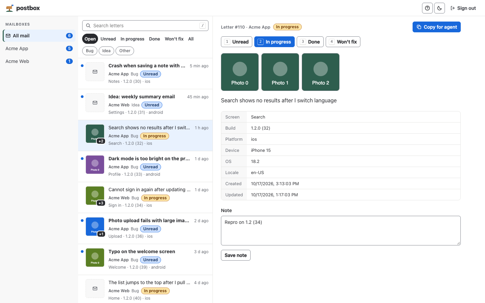

# Postbox

Postbox is the place where letters arrive: a small, self-hosted inbox for the bug reports and ideas that testers send from your apps.
Testers need no account; you read everything in one dashboard or hand an item to a coding agent with one CLI command.
It runs on Cloudflare Pages Functions, Neon Postgres (or any Postgres) and Cloudflare R2, and fits in the free tiers for a small team.



## Quick start

You need Node 22.18 or newer, pnpm, a Cloudflare account and a Postgres database (a free Neon project works).

```sh
git clone https://github.com/DalatHappyFarm/postbox.git
cd postbox
pnpm install

# 1. Pages project and R2 bucket (pick your own names; put the bucket name in wrangler.toml)
npx wrangler pages project create <your-project> --production-branch main
npx wrangler r2 bucket create <your-bucket>

# 2. Secrets (generate the admin token with: openssl rand -hex 32)
npx wrangler pages secret put DATABASE_URL --project-name <your-project>
npx wrangler pages secret put ADMIN_TOKEN --project-name <your-project>

# 3. Database schema (DATABASE_URL in the environment, never committed)
DATABASE_URL='postgres://...' pnpm db:migrate

# 4. Deploy
npx wrangler pages deploy --project-name <your-project>
```

Open the printed `*.pages.dev` address and sign in with the admin token.
Create a mailbox (a project) with the CLI below, and give its public key to your app.

## Configuration

| Name | Where | Meaning |
|---|---|---|
| `DATABASE_URL` | Pages secret | Postgres connection string |
| `ADMIN_TOKEN` | Pages secret | Bearer token for the dashboard and the CLI |
| `SHOTS` | R2 binding in `wrangler.toml` | Bucket for screenshots and photos |
| `MAX_ATTACHMENTS` and the other limits | `[vars]` in `wrangler.toml` | See Limits below |

## Layout

- `functions/api/[[path]].ts` - the Pages Function entry, one line.
- `lib/api.ts` - all handlers and validation; they take a plain `sql` tagged template and an R2-like binding, so tests run on in-process PGlite and a `Map`.
- `db/migrations/` - SQL migrations, applied in order by `pnpm db:migrate`.
- `packages/cli/` - the `postbox` command line tool.
- `packages/react-native/` - the capture kit for React Native and Expo apps.
- `public/` - the dashboard (static, strict CSP).
- `lib/limits.ts`, `lib/jpeg.ts` - limit parsing and the JPEG metadata stripper, both pure.

## API

- `GET /api/limits` (public): the active limits for clients, cached for an hour.
- `POST /api/submit` (public, CORS open): header `X-Project-Key`, optional `X-Device-Id` (the per-device rate limit is per ip without it).
  Multipart (kit 0.2.0): field `meta` (JSON `{kind, text, screen, app_version, build, platform, device, os, locale, url, device_id}`), optional `screenshot` file, `photo` files in display order, optional `thumb` (small JPEG of the first image).
  JSON (kit 0.1.0, still accepted): the same fields plus `screenshot` as base64, stored as attachment 0.
  `text` is required, `kind` is `bug|idea|other`, `platform` is `ios|android|web`; images are JPEG or PNG by magic bytes, and JPEG metadata (EXIF, GPS) is stripped on the server.
  Check order: project key, rate limit, `Content-Length` (411 if missing, 413 if too large, body unread), counts and sizes, magic bytes, stripping, parallel R2 writes.
  Returns `{id}`.
- Admin, header `Authorization: Bearer <ADMIN_TOKEN>`:
  `GET /api/feedback?project=&status=&kind=&limit=&cursor=`, `GET /api/feedback/:id` (with `attachments`), `PATCH /api/feedback/:id` (`status`, `note`), `GET /api/feedback/:id/attachments/:position`, `GET /api/feedback/:id/thumb`, `GET /api/feedback/:id/screenshot` (alias of attachment 0), `GET /api/projects`, `POST /api/projects` (`slug`, `name`).

## Limits

Every limit is a plain Pages variable in the `[vars]` block of `wrangler.toml` (and again under `[env.preview.vars]`).
Values must be positive integers; a missing or invalid value falls back to the default.
To change one: edit `wrangler.toml` and redeploy.
Clients follow a change through `GET /api/limits`; the server enforces every limit itself.

| Variable | Default | Meaning |
|---|---|---|
| `MAX_ATTACHMENTS` | 4 | Images per feedback, screenshot included |
| `MAX_IMAGE_BYTES` | 5242880 | One image after client compression |
| `MAX_TOTAL_BYTES` | 15728640 | All images of one submit together |
| `MAX_THUMB_BYTES` | 65536 | The list thumbnail |
| `MAX_TEXT` | 4000 | Note and text length (at most 10000, the database ceiling) |
| `RATE_PER_DEVICE_HOUR` | 20 | Submits per device and IP per hour |
| `RATE_PER_PROJECT_HOUR` | 200 | Submits per project per hour |

## Local development

```sh
pnpm install
pnpm test
pnpm typecheck
```

For a local server, create `.dev.vars` (git-ignored) with:

```
DATABASE_URL=postgres://...      # a development database or Neon branch
ADMIN_TOKEN=any-long-random-string
```

Then run `pnpm db:migrate` with `DATABASE_URL` in the environment, and `pnpm dev` (`wrangler pages dev`).
The R2 binding `SHOTS` is simulated locally by wrangler.
Without `DATABASE_URL` every API route answers `500 {"error":"misconfigured"}`.

## Client kit

`packages/react-native/` is `@dalathappyfarm/postbox-react-native`: shake or tap, an automatic screenshot, attached photos.
See its README for setup.

## CLI

```sh
pnpm build:cli
node packages/cli/dist/bin.js login https://<your-project>.pages.dev <ADMIN_TOKEN>
# optional: put `postbox` on the PATH
cd packages/cli && pnpm link --global
```

Config comes from `POSTBOX_URL` and `POSTBOX_TOKEN`, or from `~/.config/postbox/config.json` (written by `postbox login` with mode 600).
A config from the old `~/.config/fh/config.json` is copied once and the old file is kept.

```sh
postbox project add my-app "My App"   # prints the public key (pbk_...) for the app
postbox list [--project slug] [--status s] [--kind k] [--json]
postbox show 42 [--json]              # markdown brief; downloads every attachment to the temp dir and prints the paths
postbox status 42 doing               # new | doing | done | wont_fix
postbox note 42 "reproduced on iOS 19"
postbox done 42 --note "fixed in build 78"
```

## Security model

- Testers send with a per-project public key (`pbk_` plus 48 hex characters). It is not a secret and only allows submitting; submits are rate limited per device, IP and project.
- Reading and changing feedback needs the single `ADMIN_TOKEN`.
- Images are accepted by magic bytes only, and JPEG metadata (EXIF, GPS) is stripped on the server.
- See `SECURITY.md` to report a problem.

## Privacy and retention

Postbox stores the note, the optional screen name, app version, build, platform, device model, OS, locale and a random per-install id, plus the screenshot and photos the tester chooses to send.
The kit asks the tester for consent once and sends nothing until they tap Send.
Images are meant to be deleted after 90 days; schedule that with an R2 lifecycle rule on your bucket (the server does not delete them by itself).
Mention in-app feedback and attached photos in your own privacy policy.

## Roadmap

- Web widget for sites, besides the React Native kit.
- Notifications and webhooks on new letters.
- Triage help: duplicates, severity, screen hints.
- Postbox on its own domain and a one-command deploy.

See `docs/postbox.md` for names and vocabulary and `docs/attachments-spec.md` for the attachment contract.

## License

MIT, see `LICENSE`.
