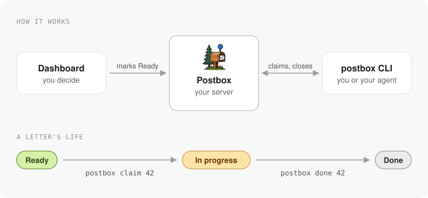

# @dalathappyfarm/postbox-cli

Command line client for a self-hosted [Postbox](https://github.com/DalatHappyFarm/postbox): work the queue of decided letters, read a brief with its photos, add a letter, and set a status.

<!-- diagram source: docs/diagrams/cli.json -->


```sh
npm install -g @dalathappyfarm/postbox-cli
postbox login https://<your-project>.pages.dev <ADMIN_TOKEN>
```

From a clone of the repository instead:

```sh
pnpm build:cli
node packages/cli/dist/bin.js login https://<your-project>.pages.dev <ADMIN_TOKEN>
# optional: put `postbox` on the PATH
cd packages/cli && pnpm link --global
```

Config comes from `POSTBOX_URL` and `POSTBOX_TOKEN`, or from `~/.config/postbox/config.json` (written by `postbox login` with mode 600).
A config from the old `~/.config/fh/config.json` is copied once and the old file is kept.

```sh
postbox project add my-app "My App"   # prints the public key (pbk_...) for the app
postbox project snippet my-site       # the <script> tag that puts the web widget on a site
postbox project origins my-site https://shop.com "https://*.shop.com" "http://localhost:*"   # only these websites may send with the key; no origins prints the list, --any clears it
postbox queue [--project slug] [--json]     # letters in Ready, highest priority then oldest
postbox claim 42 [--json]             # Ready -> In progress in one step on the server, then prints the brief; fails if the letter is not Ready (or another agent took it)
postbox brief 42 43 [--json]          # markdown brief per letter: decision, agent's note, duplicates folded in, every photo downloaded to the temp dir (an image deleted after 90 days is listed as gone)
postbox show 42 [--json]              # one brief; --json is the raw letter
postbox list [--project slug] [--status new,ready] [--kind k] [--priority 0-3|none] [--label l] [--screen s] [--source app|web] [--q text] [--sort new|old|priority] [--json]
postbox add --project my-app --text "..." [--kind bug] [--screen Home] [--photo a.png --photo b.jpg]   # add a letter from the terminal
postbox status 42 doing               # new | ready | doing | done | wont_fix
postbox note 42 "reproduced on iOS 19"           # the agent's note; the owner's decision is kept
postbox done 42 --note "fixed in build 78"       # Done, and the note says what changed and how it was checked
```

`--json` shapes are documented in `docs/agent-guide.md` of the repository.

